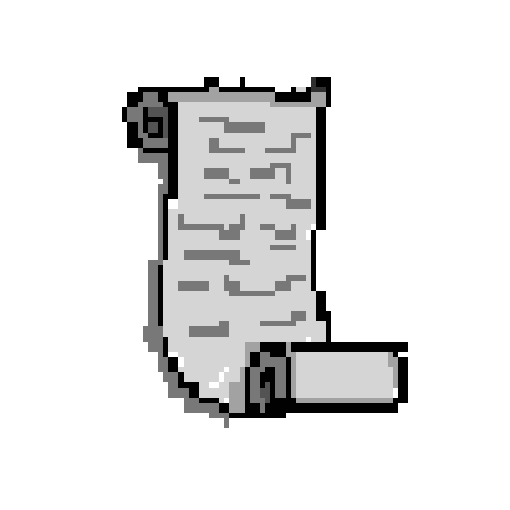

<div align="center">
  <h1>
    
    MatchMe
  </h1>
  <p><strong>An AI-powered, retro-style resume & job description matcher.</strong></p>
  <p>Upload your PDF resume, paste a job posting, and let the pixel crew show how well you match and which skills you're missing in seconds.</p>

  <p>
    <a href="https://cotesamara.github.io/MatchMe/"></a>
    
    
    
    
  </p>
</div>

---

## Meet the Crew

<p align="center">
  <br />
  <strong>Smart Cat</strong> — Checks your PDF Resume<br />
  <em>"Show me your skills"</em>
</p>

<p align="center">
  <br />
  <strong>The Recruiter</strong> — Looks over the job description requirements<br />
  <em>"This is what I want"</em>
</p>

<p align="center">
  <br />
  <strong>Pixel Chicken</strong> — Reacts to your final Overall Fit Score<br />
  <em>"Wow, looking good" / "Always room for improvement"</em>
</p>

---

## Features

- **Smart Match Scoring:** Combines **65% Required Skills** with **35% Overall Experience Fit** (`all-MiniLM-L6-v2`) so you aren't unfairly penalized for generic company text or legal disclaimers in the job post.
- **Recognizes Different Skill Names:** Automatically knows that different spellings mean the same thing (for example, `React.js` = `React`, `Postgres` = `PostgreSQL`, `RESTful APIs` = `Rest Api`).
- **Fast PDF Reading:** Pulls clean text straight out of single or multi-page PDF resumes using **PyMuPDF (`fitz`)**.
- **Clear Skill Breakdown:** Separates keywords into **Matched Skills** and **Missing Skills** so you know exactly what to add before applying.
- **Retro Pixel Design:** Dark mode (`#050814`) built with pixel fonts (`Press Start 2P` and `Silkscreen`), custom drop-shadow titles, 3D-style pixel buttons, and live speech bubbles.

---

## How the Scoring Works

```text
  [ PDF Resume ] ──► Read Resume Text (PyMuPDF) ────┐
                                                    ├──► Compare Overall Meaning (35%) ──┐
  [ Job Posting ] ──────────────────────────────────┤                                    ├──► Overall Fit %
                                                    └──► Compare Matching Skills (65%) ──┘

## What I learned
